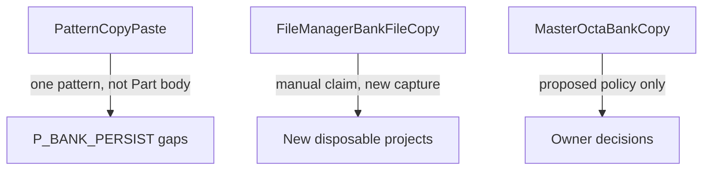

# Bank Copy operation semantics and evidence reconciliation

Work ID: `MO-PSE-BANK-COPY-SEMANTICS-RECONCILIATION-1`  
GitHub: [#181](https://github.com/kaz4g/masterocta/issues/181), [#217](https://github.com/kaz4g/masterocta/issues/217), [#221](https://github.com/kaz4g/masterocta/issues/221)  
Base SHA: [`aa0226136a7d46d6667bb5e30286bdcf46d3e9e3`](https://github.com/kaz4g/masterocta/commit/aa0226136a7d46d6667bb5e30286bdcf46d3e9e3) (`main` after PR #256)

Read-only documentation and operator runbooks only. No Bank writer, no Apply, no
mutation of tracked captures or judgment keys in source documents.

Machine-readable ledger: [`scripts/pse-bank-copy-operation-classification.json`](../../scripts/pse-bank-copy-operation-classification.json).

## Judgment (this work unit)

```text
COPY_OPERATION_CLASSIFICATION = COMPLETE
OFFICIAL_MANUAL_ALIGNMENT = PASS (scoped: confirmed quotes vs UNKNOWN claims separated)
HISTORICAL_EVIDENCE_RECONCILED = PASS
PRODUCT_COPY_POLICY = PROPOSED
OWNER_DECISIONS = EXPLICIT
NEW_DEVICE_CAPTURE_PROTOCOL = READY_FOR_OPERATOR
OLD_CAPTURE_PROMOTION = BLOCKED

BANK_COPY_APPLY_AUTHORIZED = NO
COPY_STATE_DOC_RULE = BLOCKED
BANK_CHANGEPLAN_READINESS = NOT_READY
APPLY_AUTHORIZED = NO

ISSUE_181 = OPEN
ISSUE_217 = OPEN
ISSUE_221 = OPEN

NEXT_WORK_ID = MO-PSE-BANK-FILE-COPY-DEVICE-CAPTURE-1
```

## Three operations (do not conflate)



| ID | Name | What it is | Evidence lane |
| --- | --- | --- | --- |
| **A** | Pattern Copy/Paste | Sequencer: one Pattern’s trigs and p-locks; may cross banks; **not** Part body | [`PSE_PATTERN_PASTE_PERSISTENCE.md`](./PSE_PATTERN_PASTE_PERSISTENCE.md) (`P_BANK_PERSIST`) |
| **B** | File Manager Bank file copy | Firmware File Manager copies **bank files** (manual: cross-Project); sample **audio** not copied per manual claim pending quote audit | New capture only; schema reserved — see runbook |
| **C** | MasterOCTa Bank Copy | Product whole-bank copy (same Project A→D first); not a device menu name | Policy below + [`PSE_BANK_COPY_REMAP_PREVIEW.md`](./PSE_BANK_COPY_REMAP_PREVIEW.md) |

### Legacy name `NATIVE_BANK_COPY`

[`PSE_BANK_COPY_STATE_DOC_DEVICE_EVIDENCE.md`](./PSE_BANK_COPY_STATE_DOC_DEVICE_EVIDENCE.md) and
[`scripts/pse-bank-copy-state-doc-device-evidence.mjs`](../../scripts/pse-bank-copy-state-doc-device-evidence.mjs)
keep `NATIVE_BANK_COPY` as a **compatibility alias** for Operation **A** metadata
(`pattern_copy_paste`). It does **not** mean firmware whole-bank copy is
`DEVICE_CONFIRMED`. The harness accepts only `pattern_copy_paste` and
`NATIVE_BANK_COPY`; it **rejects** `bank_copy` and must **not** be extended to
accept File Manager kinds (contract-tested).

The Octatrack does **not** expose a Sequencer operation that copies an entire
bank in one step; whole-bank behavior is a **product** question (C) or a **File
Manager file** question (B).

## Official manual alignment (Operation B)

Evidence classes follow [source policy](../../.agents/skills/masterocta-format-evidence/references/source-policy.md).

| Claim | Class | Citation |
| --- | --- | --- |
| `.work` = active working document; `.strd` = saved checkpoint on media | **MANUAL_CONFIRMED** | Octatrack MkII User Manual OS 1.40A, §8.5.5 FILE MANAGER (~p.37); see also [`MO_RC8_HARDWARE_CONTRAST_TRIAL.md`](../testing/MO_RC8_HARDWARE_CONTRAST_TRIAL.md) |
| Project SAVE / RELOAD vs working cache | **MANUAL_CONFIRMED** | Same manual §8.4.1 (~p.31) |
| File Manager can copy a **bank** to another **Project** | **UNKNOWN** until this work unit records PDF section + verbatim quote in capture metadata | Do not promote from issue text alone |
| Sample **audio** is not copied with bank file copy | **UNKNOWN** (pending quote + Experiment B) | |
| Static/Flex **slot numbers** preserved | **UNKNOWN** (pending quote + Experiment B) | |
| Per-bank `.work` / `.strd` update order and flush on File Manager copy | **UNKNOWN** | Manual does not name on-card filenames |

`OFFICIAL_MANUAL_ALIGNMENT = PASS` means confirmed manual facts are separated from
claims that still require quote + device capture — not that every Operation B
claim is `MANUAL_CONFIRMED`.

## Historical evidence re-audit

Judgment keys inside each source document are **unchanged**. This table is the
reconciliation view for MasterOCTa Bank Copy (Operation **C**).

| Evidence | Op | Class | Capture integrity | Apply to C |
| --- | --- | --- | --- | --- |
| `P_BANK_PERSIST` | A | DEVICE_CONFIRMED | PASS (scoped) | Save-timing observation only; not whole-bank rules |
| `P_BANK_COPY_STATE` | A (attempt) | REJECTED | FAIL (`STOP_WITH_FINDINGS`) | **None** — promotion **BLOCKED** |
| Phase B matrix | A (attempt) | REJECTED | FAIL | **None** |
| `#221` device-copy A→B/C (`P_BANK_ID2`, etc.) | **UNKNOWN** (procedure) | DEVICE_CONFIRMED (identity scope) | PASS (scoped) | **BANK_INTERNAL_IDENTITY** only |
| Remap preview | C | CODE_CONFIRMED | N/A | Read-only model; not Apply evidence |
| ChangePlan closeout | C | CODE_CONFIRMED | N/A | Planner only; `COPY_STATE_DOC_RULE` **BLOCKED** |
| State-doc semantics 2 | C | UNKNOWN / blocked rules | N/A | Classification; no rule promotion |

Detailed columns (per Task 2):

| Evidence | OPERATION_KIND | SOURCE_DOCUMENT | DEVICE_FIRMWARE | CAPTURE_SESSION | PROVEN_BEHAVIOR (short) | UNPROVEN_BEHAVIOR (short) |
| --- | --- | --- | --- | --- | --- | --- |
| `P_BANK_PERSIST` | A | PATTERN_PASTE_PERSISTENCE | R0173 / 1.40 | Continuous (operator confirmed) | Pattern paste; bank02 work/strd timing | Reload sentinel; transport |
| `P_BANK_COPY_STATE` | A alias | BANK_COPY_STATE_DOC | R0173 / 1.40 | **Not proven** (mixed S3 redo) | Raw bytes partially nested | Copy attribution; UI labels |
| Phase B | A alias | PHASE_B_MATRIX | R0173 / 1.40 | **NOT_PROVEN** | Pre-source work≠strd at S1 | All post-copy stages |
| `#221` captures | UNKNOWN | BANK_INTERNAL_IDENTITY | R0173 / 1.40 | Scoped per fixture | Parser has no bank index field | Operation B vs A |
| Remap preview | C (model) | BANK_COPY_REMAP_PREVIEW | N/A | N/A | Slot remap preview deterministic | Device roles |
| Closeout | C (planner) | CHANGEPLAN_CLOSEOUT | N/A | N/A | Read-only planner exists | Full affected files |
| Semantics 2 | C (blocked) | STATE_DOC_SEMANTICS_2 | N/A | N/A | Same-role safety constraints | Copy SavedCheckpoint meaning |

## MasterOCTa Bank Copy — proposed product policy (Operation C)

`PRODUCT_COPY_POLICY = PROPOSED`. Same Project **Bank A → Bank D** is the first
scenario. Cross-Project copy remains hypothetical until Operation B device
evidence and owner slot policy exist.

### SavedCheckpoint (owner decision — not chosen)

| Alternative | RISK |
| --- | --- |
| Replicate source **SavedCheckpoint** (`bankD.strd`) from source saved state | Overwrites destination rollback point; may not match device if firmware treats strd differently |
| Preserve destination **SavedCheckpoint**; write Working only | Device RELOAD may not reflect copied performance; user expects “full bank” copy may be violated |
| Write **Working** (`bankD.work`) only; leave SavedCheckpoint policy **explicitly undecided** in UI | Safest fail-closed default for MasterOCTa until #217 evidence; hardware behavior unknown |

`COPY_SAVED_CHECKPOINT_SEMANTICS` stays **UNKNOWN**. `OWNER_DECISION_REQUIRED = YES`.

### Policy matrix (A→D, same Project)

| Topic | CURRENT_EVIDENCE | PROPOSED_PRODUCT_POLICY | ALTERNATIVES | RISKS | OWNER_DECISION_REQUIRED | DEVICE_EVIDENCE_REQUIRED |
| --- | --- | --- | --- | --- | --- | --- |
| 16 Patterns | No whole-bank device copy | Copy full pattern payload from source bank file scope | Pattern subset copy (reject) | Incomplete bank | NO | YES (C) |
| 4 Parts | Pattern paste does not copy Part body (#217) | Copy saved + unsaved part payload per ChangePlan scope when Apply exists | Working-only parts | Unsaved loss | NO | YES |
| Scenes / Track settings | In bank file bytes; not isolated in capture | Copy as part of bank document write set | Exclude scenes (reject for “whole bank”) | Broken performance | NO | YES |
| Working (`bankD.work`) | Pattern paste: dest work flush on bank switch (#217) | Overwrite destination Working from source Working snapshot at Apply time | Deferred flush | Stale UI vs card | NO | YES |
| SavedCheckpoint (`bankD.strd`) | **UNKNOWN** | **Do not auto-decide** — gate Apply on owner + device evidence | See SavedCheckpoint table above | Data loss on RELOAD | **YES** | **YES** |
| Destination overwrite range | ChangePlan lists candidate roles | Replace destination bank documents in approved envelope only | Partial merge | Orphan refs | NO | YES |
| Active Bank / Pattern (`project.work` `[STATES]`) | Pattern paste retarget observed on save | Retarget policy **DEVICE_EVIDENCE_REQUIRED**; default fail-closed | Leave `[STATES]` unchanged | Wrong active bank | MAYBE | YES |
| Arranger references | Readiness gap open (#181) | Block Apply until arranger coverage proven or explicitly excluded | Best-effort copy | Broken arranger | YES | YES |
| Recorder dependencies | Readiness gap open | Same as Arranger | Ignore recorder | Silent breakage | YES | YES |
| Sample slot numbers | Remap preview: same Project **PreserveSlotNumbers** (CODE) | Preserve slot numbers; remap only on cross-project (future) | Upstream lowest-free | Collisions | NO (same project) | YES (cross-project) |
| Verification / Recovery | BMS contract | Pre-write plan + manifest + backup/trash per mutation contract | Skip verification | Irreversible media harm | NO | N/A (product gate) |

## New device capture protocol (operator)

Do **not** reuse `P_BANK_COPY_STATE` or re-run `P_BANK_PERSIST` for these gaps.
Runbook: [`PSE_BANK_FILE_COPY_DEVICE_ACCEPTANCE.md`](../testing/PSE_BANK_FILE_COPY_DEVICE_ACCEPTANCE.md).

| Experiment | Operation | Disposable project | Harness schema |
| --- | --- | --- | --- |
| A — Pattern paste gaps | A | New name (not `P_BANK_PERSIST`) | `masterocta.pse-pattern-paste-gap-capture:v1` (reserved) |
| B — File Manager bank copy | B | New name (not `P_BANK_COPY_STATE`) | `masterocta.pse-bank-file-copy-device-capture:v1` (reserved) |

Experiment A fills **capture_transport** and **post-reload UI sentinel** gaps
from `P_BANK_PERSIST` without extending Pattern paste conclusions to Operation B.

Experiment B harness is **`MO-PSE-BANK-FILE-COPY-DEVICE-CAPTURE-1`** (merged:
[`scripts/pse-bank-file-copy-device-capture.mjs`](../../scripts/pse-bank-file-copy-device-capture.mjs),
runbook updated). **Device capture not run** in that PR (`DEVICE_CAPTURE = NOT_RUN`).
Operator execution: **`MO-PSE-BANK-FILE-COPY-DEVICE-EXECUTE-1`** (follow-on).

## Safety gates (unchanged)

```text
PATTERN_COPY_APPLY_AUTHORIZED = NO
BANK_COPY_APPLY_AUTHORIZED = NO
COPY_STATE_DOC_RULE = BLOCKED
MOVE_STATE_DOC_RULE = BLOCKED
SWAP_STATE_DOC_RULE = BLOCKED
LEGACY_WRITE_GATE = UNCHANGED
```

## Commands (this work unit)

```bash
node scripts/pse-bank-copy-state-doc-device-evidence.mjs status
node --test scripts/pse-bank-copy-state-doc-device-evidence.test.mjs
node --test scripts/pse-bank-copy-operation-classification.test.mjs
node scripts/pse-bank-file-copy-device-capture.mjs status
node --test scripts/pse-bank-file-copy-device-capture.test.mjs
node scripts/pse-read-model-check.mjs
pnpm run check:pse-bank-mutation
```

Rust tests and Clippy were not required for docs-only + Node ledger changes; do
not report them as PASS if unrun.

## Related documents

| Document | Role |
| --- | --- |
| [`PSE_PATTERN_PASTE_PERSISTENCE.md`](./PSE_PATTERN_PASTE_PERSISTENCE.md) | Operation A device evidence |
| [`PSE_BANK_COPY_STATE_DOC_DEVICE_EVIDENCE.md`](./PSE_BANK_COPY_STATE_DOC_DEVICE_EVIDENCE.md) | Rejected A-alias capture |
| [`PSE_BANK_COPY_STATE_DOC_DEVICE_EVIDENCE_PHASE_B_MATRIX.md`](./PSE_BANK_COPY_STATE_DOC_DEVICE_EVIDENCE_PHASE_B_MATRIX.md) | Rejected matrix |
| [`PSE_BANK_INTERNAL_IDENTITY.md`](./PSE_BANK_INTERNAL_IDENTITY.md) | #221 identity |
| [`PSE_BANK_STATE_DOC_SEMANTICS_2.md`](./PSE_BANK_STATE_DOC_SEMANTICS_2.md) | Blocked rules |
| [`PSE_BANK_CHANGEPLAN_CLOSEOUT.md`](./PSE_BANK_CHANGEPLAN_CLOSEOUT.md) | Planner closeout |
| [`PSE_BANK_COPY_REMAP_PREVIEW.md`](./PSE_BANK_COPY_REMAP_PREVIEW.md) | Remap preview |
